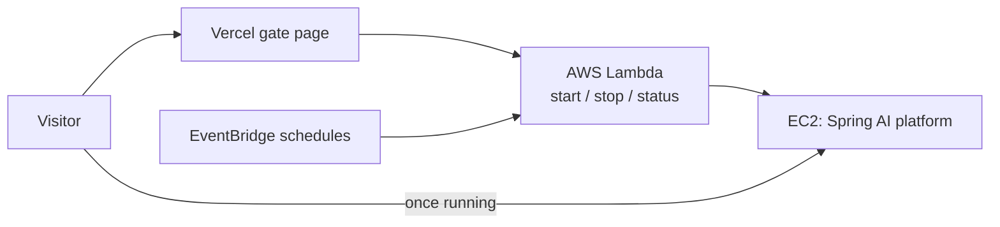

# Hi, I'm Tushar Kulkarni 👋
 
Software engineer with two years of experience building backend and AI systems in **Java** and **Python**. I like owning a system from architecture to deployment, and I'm currently focused on bringing **Spring AI** and agent workflows into production-grade, multi-tenant applications.
 
---
 
## 🛠 Core stack
 

  

| Area | Tools |
|---|---|
| Backend | Java 21, Spring Boot, Spring Security, Python, FastAPI |
| AI / Agents | Spring AI, Google ADK, multi-provider LLM integration |
| Cloud & Delivery | AWS (EC2, Lambda, ECR, EventBridge), Docker, Maven |
| Data | PostgreSQL, MySQL, MongoDB, Redis |
 
---
 
## 🚀 Featured projects
 
### 🤖 Multi-Provider Spring AI Agentic Platform
A chat platform where users create their own agents and assign workflows, built on Spring AI with support for multiple LLM providers and a Next.js front end.
 
- **Live demo:** [www.kulkarni.store](https://www.kulkarni.store) (source is private)
- **Hosting:** runs on my own AWS EC2 instance, started on demand through a small gate I built called *UpTimeGate*

 
### 🔐 Spring Boot Security Library *(open source)*
A reusable security library packaged as Spring Boot starters (JWT, Redis, Actuator) that I share across my own projects. Built with Maven on Java 21 and virtual threads, with a goal of supporting several Spring Boot versions.
---

## 🌱 Currently exploring
 
- Spring AI and agent workflows on the JVM
- Multi-tenant isolation in AI systems (tokens, sessions, per-tenant agent composition)
- RAG pipeline architecture and how Java fits alongside Python-first AI tooling
---
 
## 🎓 Education
 
B.Tech in Computer Science, Savitribai Phule Pune University
Full-Stack Web Development Certification, Udemy
 
---
 
## 📫 Connect
 

 
